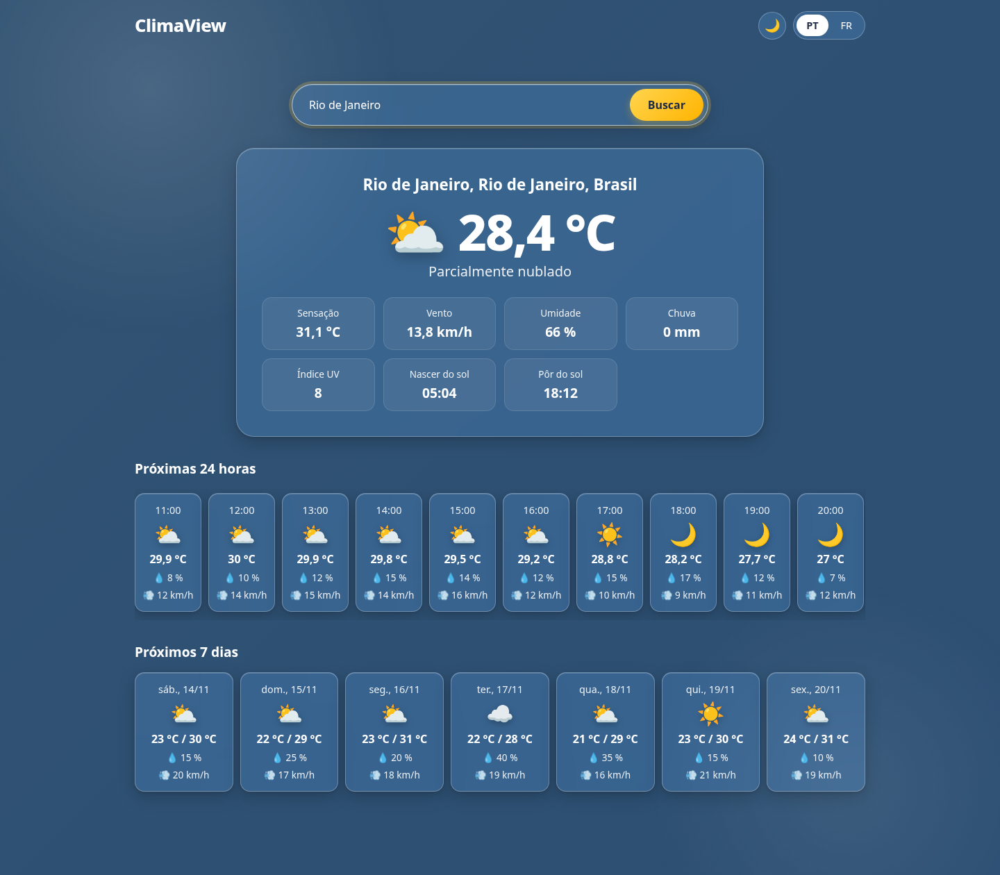

# ClimaView

**Weather, without the noise.**

A simple, bilingual weather app that makes forecasts easy to explore. Just search for a city and see what the day looks like.

[**Live Demo ↗**](https://brumo97.github.io/Climaview-By-Bruno/) · [HTML source](./index.html)

*Interface preview with sample weather data.*

### Features

- Current conditions, next 24 hours, and 7-day forecast
- City search worldwide
- Weather-inspired backgrounds and light/dark mode
- Brazilian Portuguese and French interfaces

### Made with

HTML · CSS · Vanilla JavaScript · [Open-Meteo](https://open-meteo.com/)

No frameworks. No build step.

### Run locally

Download the project and open `index.html` in your browser. An internet connection is needed to load live forecasts.

### Em português 🇧🇷

O ClimaView nasceu de uma ideia simples: consultar a previsão do tempo de um jeito claro, rápido e sem complicações.

---

Designed & built by [Bruno Moreau](https://github.com/brumo97). Curious about what's next? [Follow along](https://github.com/brumo97).
